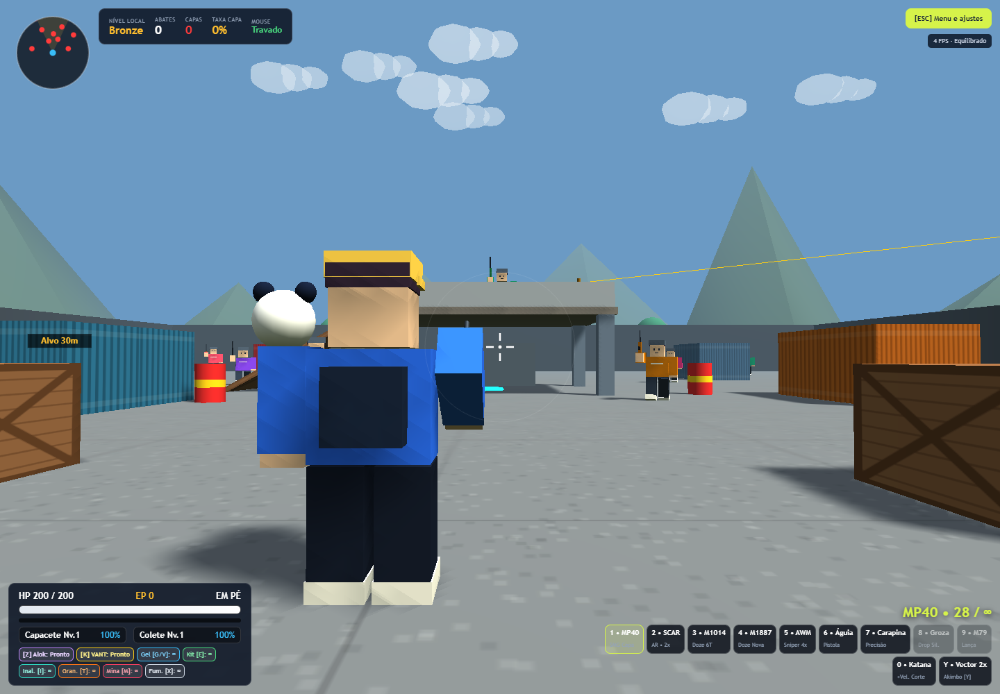

# Block Arena

Jogo 3D de tiro em terceira pessoa para navegador, com personagens de blocos, personalização, modos contra bots e duelo casual com um amigo.


## Jogar

1. [Baixe o repositório em ZIP](https://github.com/heitormtsantos/GameWeb/archive/refs/heads/main.zip) e extraia os arquivos.
2. Abra `index.html` no Chrome ou Edge.
3. Escolha o modo e clique em **Jogar agora**.

A edição de arquivo único está em [`downloads/block-arena.html`](downloads/block-arena.html). Baixe esse arquivo e abra no navegador. Os modos locais funcionam offline: as bibliotecas estão incluídas no projeto.

Esta versão usa **teclado e mouse**. A interface se adapta a telas pequenas; controles de toque ainda não estão implementados.

## Modos

| Modo | Como funciona |
| --- | --- |
| Treino livre | Arsenal, alvos e bots para praticar |
| Battle Royale | Você e 11 bots; vença como último sobrevivente |
| Duelo com bot | 1 contra 1, melhor de sete rounds |
| Contra Squad | 1 contra 3 bots, com loja entre rounds |
| Sobrevivência | Ondas de bots e chefão a cada três ondas |
| X1 com amigo | Duelo online casual por código de sala |

O X1 precisa de internet e conectividade WebRTC. Crie uma sala, compartilhe o código de quatro números, aguarde a conexão e inicie nos dois navegadores. O menu não pausa o adversário. O protocolo foi testado com uma conexão simulada; uma partida real entre redes diferentes ainda precisa ser validada.

## Controles

| Tecla ou botão | Ação |
| --- | --- |
| WASD / Shift / Espaço | Mover / correr / pular |
| C ou Ctrl | Agachar |
| Mouse esquerdo / direito | Atirar / mirar |
| Roda do mouse, 1–0 ou Y | Trocar arma |
| R / Q | Recarregar / arma anterior |
| G ou V | Parede de gel |
| E / I | Kit / inalador |
| T / M / X | Granada / mina / fumaça |
| Z / K | Habilidade / VANT |
| Enter | Interagir com veículo ou tirolesa |
| Alt / U / B | Olhar livre / trocar ombro / emote |
| Esc, P ou H | Menu e configurações |

Use o menu para ajustar sensibilidade, assistência de mira, bots, voz e qualidade gráfica. A pausa local preserva posição, recarga, granadas e ações agendadas. Mudar de aba também pausa o jogo local.

## Personalização e desempenho

- Avatares de blocos com rosto, cabelo, boné, roupa e tom de pele.
- Prévia 3D que pode ser girada com o mouse.
- Três presets gráficos: Leve, Equilibrado e Detalhado.
- Reutilização de partículas e geometrias, cache de obstáculos e liberação de recursos gráficos.
- Renderização suspensa no lobby e durante a pausa local.
- Recuperação de saves inválidos e aviso quando o navegador bloqueia o armazenamento.



## Desenvolvimento

O jogo usa JavaScript, Three.js r128 e PeerJS 1.5.5. Não há etapa de instalação ou compilação para jogar.

Para servir o projeto por HTTP:

```sh
python -m http.server 8000
```

Abra `http://localhost:8000`.

Para gerar novamente a edição de arquivo único:

```sh
python build-standalone.py
```

O resultado fica em `downloads/block-arena.html`.

Para executar as verificações de desenvolvimento, use Node.js e Chrome instalado:

```sh
npm ci
npm run check
npm test
```

Os testes usam um servidor local temporário e uma cópia instrumentada do script. Resultados e capturas ficam em `test-results/`, fora do controle de versão. Para usar o Chromium fornecido pelo Playwright, instale-o com `npx playwright install chromium` e defina `ARENA_BROWSER=chromium` ao executar os testes.

| Arquivo | Responsabilidade |
| --- | --- |
| `index.html` | Telas e carregamento dos scripts |
| `styles.css` / `theme.css` | Estilos do jogo, lobby, pausa e layout adaptável |
| `runtime.js` | Armazenamento, relógio, agendamento e descarte de recursos |
| `avatars.js` | Personagens e geometrias compartilhadas |
| `browser-ui.js` | Prévia 3D, diálogos e controles do navegador |
| `game.js` | Regras, combate e simulação |
| `vendor/` | Bibliotecas e respectivas licenças |
| `tests/` | Verificações de sintaxe e regressão no navegador |

## Estado da versão

Foram aprovadas 21 verificações de regressão no Chrome com WebGL por software, além da abertura offline das edições modular e de arquivo único. Um teste de 20 ciclos de efeitos e limpeza manteve estáveis os totais de geometrias e texturas. Isso não representa uma medição de FPS em hardware real. Veja [`VALIDACAO.txt`](VALIDACAO.txt).

O progresso e as patentes são **locais**, salvos no navegador. Ainda não há contas, banco de dados ou ranqueada competitiva. O X1 P2P é casual; resultados competitivos exigirão validação por servidor.

As bibliotecas incluídas mantêm suas licenças MIT em `vendor/three.LICENSE.txt` e `vendor/peerjs.LICENSE.txt`.
