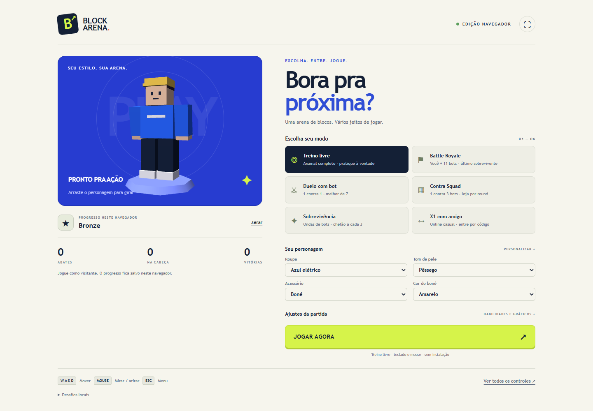
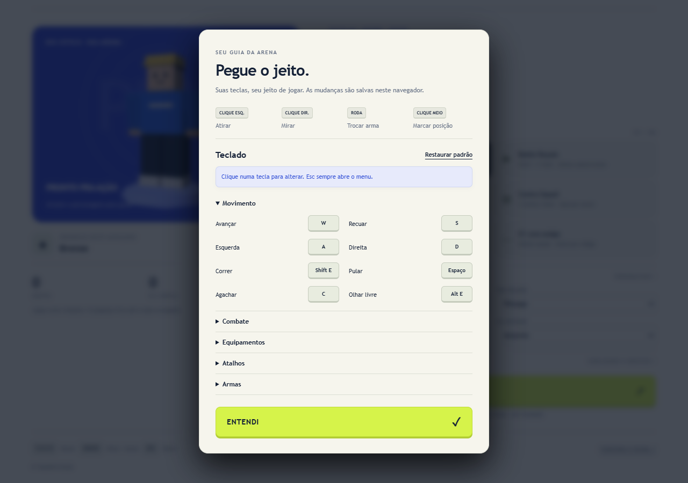

# Block Arena

Jogo 3D de tiro em terceira pessoa para navegador, com personagens de blocos, personalização, modos contra bots e duelo casual com um amigo.



## Jogar

**[Jogar no navegador](https://heitormtsantos.github.io/GameWeb/)**

O site é publicado pelo GitHub Actions depois das verificações automáticas. Também é possível jogar offline:

1. [Baixe o repositório em ZIP](https://github.com/heitormtsantos/GameWeb/archive/refs/heads/main.zip) e extraia os arquivos.
2. Abra `index.html` no Chrome ou Edge.
3. Escolha o modo e clique em **Jogar agora**.

A edição de arquivo único está em [`downloads/block-arena.html`](downloads/block-arena.html). Baixe esse arquivo e abra no navegador. Os modos locais funcionam offline: as bibliotecas estão incluídas no projeto.

Esta versão usa **teclado e mouse**. A interface se adapta a telas pequenas; controles de toque ainda não estão implementados.

## Modos

| Modo          | Como funciona                                  |
| ------------- | ---------------------------------------------- |
| Treino livre  | Arsenal, alvos e bots para praticar            |
| Battle Royale | Você e 11 bots; vença como último sobrevivente |
| Duelo com bot | 1 contra 1, melhor de sete rounds              |
| Contra Squad  | 1 contra 3 bots, com loja entre rounds         |
| Sobrevivência | Ondas de bots e chefão a cada três ondas       |
| X1 com amigo  | Duelo online casual por código de sala         |

O X1 precisa de internet e conectividade WebRTC. Crie uma sala, compartilhe o código de quatro números, aguarde a conexão e inicie nos dois navegadores. O menu não pausa o adversário. O protocolo foi testado com uma conexão simulada; uma partida real entre redes diferentes ainda precisa ser validada.

## Controles

| Tecla ou botão           | Ação                               |
| ------------------------ | ---------------------------------- |
| WASD / Shift / Espaço    | Mover / correr / pular             |
| C ou Ctrl                | Agachar                            |
| Mouse esquerdo / direito | Atirar / mirar                     |
| Roda do mouse, 1–0 ou Y  | Trocar arma                        |
| R / Q                    | Recarregar / arma anterior         |
| G ou V                   | Parede de gel                      |
| E / I                    | Kit / inalador                     |
| T / M / X                | Granada / mina / fumaça            |
| Z / K                    | Habilidade / VANT                  |
| Enter                    | Interagir com veículo ou tirolesa  |
| Alt / U / B              | Olhar livre / trocar ombro / emote |
| Esc, P ou H              | Menu e configurações               |

Use o menu para ajustar sensibilidade, assistência de mira, bots, voz e qualidade gráfica. A pausa local preserva posição, recarga, granadas e ações agendadas. Mudar de aba também pausa o jogo local.

Em **Controles e teclas**, clique na tecla de uma ação e pressione a substituta. Conflitos são indicados sem sobrescrever outra ação. Esc cancela a captura e permanece disponível para abrir o menu. As mudanças ficam salvas neste navegador; **Restaurar padrão** desfaz as personalizações. Os controles da tabela acima são os padrões.



## Personalização e desempenho

- Avatares de blocos com rosto, cabelo, boné, roupa e tom de pele.
- Joelhos e cotovelos articulados, postura de mira, movimento secundário na corrida e amortecimento de aterrissagem.
- Prévia 3D que pode ser girada com o mouse.
- Três presets gráficos: Leve, Equilibrado e Detalhado.
- Reutilização de partículas e geometrias, cache de obstáculos e liberação de recursos gráficos.
- Renderização suspensa no lobby e durante a pausa local.
- Recuperação de saves inválidos e aviso quando o navegador bloqueia o armazenamento.
- Pente independente para cada arma: trocar não recarrega. Uma recarga cancelada não concede munição; os pentes são repostos no início de partida/round e no respawn.
- Simulação fixa a 60 Hz, separada da renderização. Quadros lentos acumulam passos pendentes em vez de descartar o tempo normal de jogo.


## Desenvolvimento

O jogo usa JavaScript, Three.js r128 e PeerJS 1.5.5. Não há etapa de instalação ou compilação para jogar.

Para servir o projeto por HTTP:

```sh
python -m http.server 8000
```

Abra `http://localhost:8000`.

Para gerar novamente a edição de arquivo único:

```sh
python build-standalone.py
```

O resultado fica em `downloads/block-arena.html`.

Para executar as verificações de desenvolvimento, use Node.js e Chrome instalado:

```sh
npm ci
npm ci --prefix backend
npm run check
npm test
```

Os testes usam um servidor local temporário e uma cópia instrumentada do script. Resultados e capturas ficam em `test-results/`, fora do controle de versão. Para usar o Chromium fornecido pelo Playwright, instale-o com `npx playwright install chromium` e defina `ARENA_BROWSER=chromium` ao executar os testes.

| Arquivo                          | Responsabilidade                                           |
| -------------------------------- | ---------------------------------------------------------- |
| `index.html`                     | Telas e carregamento dos scripts                           |
| `styles.css` / `theme.css`       | Estilos do jogo, lobby, pausa e layout adaptável           |
| `runtime.js`                     | Armazenamento, relógio, agendamento e descarte de recursos |
| `save-model.js`                  | Contrato compartilhado de progresso entre jogo e API       |
| `accounts.js` / `account-ui.js`  | Sessões, sincronização, login e perfil                     |
| `backend/`                       | API Fastify, PostgreSQL, migrações e Docker para VPS       |
| `combat-state.js`                | Pentes independentes por arma                              |
| `controls.js` / `controls-ui.js` | Mapeamento, conflitos e editor de teclas                   |
| `avatars.js`                     | Personagens e geometrias compartilhadas                    |
| `avatar-motion.js`               | Articulação, postura, orientação da arma e aterrissagem    |
| `browser-ui.js`                  | Prévia 3D, diálogos e controles do navegador               |
| `game.js`                        | Regras, combate e simulação                                |
| `vendor/`                        | Bibliotecas e respectivas licenças                         |
| `tests/`                         | Verificações de sintaxe e regressão no navegador           |

## Estado da versão

Os testes cobrem munição por arma, recarga cancelada, teclas configuráveis, persistência, pausa, efeitos, modos de jogo e o sistema de contas. A integração de contas usa uma API HTTP real e PostgreSQL embarcado, com dois dispositivos, troca de conta, alterações offline, resposta perdida e conflitos de save. O relógio e a integração de movimento/recarga são exercitados entre 5 e 144 FPS simulados. O navegador de teste usa WebGL por software; esses testes não representam uma medição de FPS em hardware real. Veja [`VALIDACAO.txt`](VALIDACAO.txt).

O workflow `.github/workflows/pages.yml` verifica sintaxe, testes unitários, API, navegador e containers com PostgreSQL. Em seguida, regenera o HTML único, monta uma pasta com somente os arquivos públicos e publica no GitHub Pages. `python build-site.py` prepara localmente essa mesma pasta em `site/`.

## Contas e progresso online

O sistema inclui cadastro por e-mail e senha, login, perfil com apelido, alteração de senha e progresso salvo por conta. Aparência, configurações, teclas e estatísticas casuais acompanham o jogador entre dispositivos. Cada conta tem seu próprio cache; o save de visitante fica separado e pode ser importado explicitamente para uma conta vazia. Alterações offline aguardam sincronização, e conflitos permitem escolher a versão online ou a do dispositivo.

A API está pronta para hospedar na sua VPS com Docker e PostgreSQL. **Enquanto a VPS não estiver configurada, o site mantém o modo visitante e informa que as contas estão indisponíveis.** O GitHub Pages hospeda somente o frontend.

Siga o [guia do backend](backend/README.md) para subir a API com HTTPS. Depois, defina a variável de repositório `GAMEWEB_API_URL` com a origem pública da API e execute o workflow para ativar as contas no site. Essa variável não deve conter credenciais.

Ainda não há ranqueada competitiva, verificação de e-mail ou recuperação automática de senha. O perfil permite alterar a senha; o guia inclui recuperação administrativa. As patentes e o X1 P2P são casuais; resultados competitivos exigirão validação por servidor.

As bibliotecas incluídas mantêm suas licenças MIT em `vendor/three.LICENSE.txt` e `vendor/peerjs.LICENSE.txt`.
